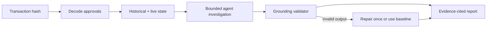

# TraceIntel

**An evidence-grounded security agent for token approvals.** TraceIntel reconstructs what an EVM transaction approved, checks what that permission can do now, and recommends whether to revoke, verify, or review it.

[Live app](https://traceintel.eshita.dev) · [1:44 walkthrough](https://drive.google.com/file/d/1-5eEX6gudDaP5FLFxx9WotcHQ9CJlThD/view) · [Agent design](docs/agents.md) · [Evaluations](evals/README.md) · [Architecture](docs/architecture.md)


## The problem

Token approvals can outlive the swap that created them. An unlimited permission may remain active for months, while the approved spender can be upgraded, compromised, or placed under different control.

Block explorers show what a transaction did. TraceIntel answers the harder question: **what can this approval still do, what changed since it was granted, and should I revoke it?**

## What the report gives you

Paste an Ethereum or Monad transaction hash. For every approval controlled by the sender, TraceIntel returns:

- the original approval and the permission that remains live;
- the spender's current code, proxy, and upgrade-control evidence;
- a recommendation: **revoke**, **verify**, or **review**;
- citations back to the exact on-chain facts behind every claim; and
- a complete trace of the agent's plan, tool calls, rejections, and repairs.

The product is read-only and never asks for a wallet connection.

## See it working

| Path | What it shows |
| --- | --- |
| [Open the live app](https://traceintel.eshita.dev) | Run a transaction when the API is awake. The free backend can take up to two minutes to start. |
| [Watch the recorded walkthrough](https://drive.google.com/file/d/1-5eEX6gudDaP5FLFxx9WotcHQ9CJlThD/view) | A complete 1:44 product walkthrough. |
| Use a recorded example on the homepage | Replay a full analysis and inspect its report even when the backend is offline. |

## How it works

1. **Decode the transaction.** Parse every ERC-20 and ERC-721 approval and separate the sender's permissions from approvals created by contracts inside the same transaction.
2. **Reconstruct then and now.** Read the historical approval and current allowance, balance, bytecode, and proxy state at pinned, revalidated blocks.
3. **Investigate live risk.** A bounded agent profiles the spender, checks upgrades and upgrade authority, and compares current state with the original permission.
4. **Return a defensible action.** A grounding validator accepts only claims supported by collected evidence. Invalid output gets one repair attempt, then falls back to deterministic advice.



## Why the model cannot invent the report

| Guardrail | Implementation |
| --- | --- |
| Code owns the facts | Python converts chain evidence into a claim catalog. The model selects claim IDs; it does not write new facts, numbers, or addresses. |
| Tools are typed and bounded | The planner can call only `spender_profile`, `upgrade_control`, or `known_spender`, only for known permission IDs, under a hard call budget. |
| Every sentence is validated | Unknown claims, unsupported actions, and out-of-scope permissions are rejected before the report is stored. |
| Failure is safe | The reporter gets one repair attempt. If the model or provider fails, the deterministic baseline still returns grounded advice. |
| Inputs are hardened | Attacker-controlled token symbols and contract names never enter the model prompt. Provider errors never enter reports or logs. |

The agent runs on [NOOA](docs/nooa.md), NVIDIA's agent framework, with OpenRouter models. The full reasoning design and rejected alternatives are documented in [docs/agents.md](docs/agents.md).

## Evidence that it works

The current CI suite proves the claims made above rather than only testing happy paths:

- **24/24 offline evaluation cases**, including historical rules, approval ownership, six exposure transitions, eight labelled agent scenarios, and five adversarial guardrail cases;
- **101 automated tests**: 66 backend tests, 20 frontend unit tests, and 15 Playwright browser tests;
- backend tests run against both **SQLite and PostgreSQL**;
- strict mypy, Ruff, ESLint, TypeScript, and production builds;
- a Docker build plus an assigned-port readiness smoke test; and
- a Cloudflare Worker deployment dry run.

The adversarial cases script prompt injection, fabricated claims, invalid tool calls, advice for another owner's permission, and provider failure. All run without a network, model provider, or RPC. See the [evaluation methodology and fixtures](evals/README.md).

## Engineering details

- **Chain correctness:** EIP-1898 block-hash pinning, reorg invalidation, archive-RPC fallback labels, exact uint256 strings, EIP-7702 delegated accounts, and UNI-style uint96 infinite approvals.
- **Agent reliability:** frozen Pydantic models, typed tools, hard budgets, model-call traces, one-shot repair, and a deterministic benchmark/fallback.
- **Backend resilience:** stale-worker leases, a self-healing heartbeat, atomic SQL budgets, refunds for missing transactions, and structured logs that exclude secrets.
- **Frontend resilience:** recorded analyses remain usable while the hosted backend sleeps or is unavailable.

## Stack

| Layer | Technology |
| --- | --- |
| Agent | NVIDIA NOOA `PredictStrategy`, OpenRouter, typed tool calls, grounding validator |
| Backend | Python 3.12, FastAPI, Pydantic, SQLAlchemy, Alembic |
| On-chain | EVM JSON-RPC, ABI/event decoding, ERC-20/721, EIP-1967, EIP-1898, EIP-7702 |
| Frontend | React 19, TypeScript, Vite |
| Infrastructure | Docker, Render, PostgreSQL, Cloudflare Workers, GitHub Actions |

## Run locally

Requirements: Python 3.12, [uv](https://docs.astral.sh/uv/), Node 22.12+, npm, and Make. NOOA imports `fcntl`, so Windows development requires WSL.

```sh
cp .env.example .env
make install
make backend     # terminal 1: migrations, then localhost:8000
make frontend    # terminal 2: localhost:5173
```

`OPENROUTER_API_KEY` is optional. Without it, the rule-based baseline produces the investigation and advice, so the system still runs without a model provider.

## Test and evaluate

```sh
make check        # lint, types, unit tests, frontend build
make evaluate     # 24 offline evaluation cases

cd frontend
npx playwright install chromium
npm run test:e2e  # 15 browser tests
```

The same checks run in [GitHub Actions](.github/workflows/ci.yml).

## Supported networks

Ethereum and Monad use the same EVM analysis pipeline. Adding another chain requires a registry entry and an RPC URL.

## Current limitations

- Analysis is a snapshot, not continuous monitoring. "Now" means the pinned block recorded in the report.
- A run covers one transaction's permissions, not every approval in a wallet.
- "Changed since approval" requires historical state. Older Monad history may be unavailable from free RPC providers.
- Proxy analysis currently covers EIP-1967. Upgrade authority implemented elsewhere is reported as undetermined.
- ERC-4337 smart-account approvals appear as other-contract approvals because bundlers submit the transaction.
- Recommendations explain evidence and risk. They are not safety ratings.

## Documentation

- [Agent architecture and guardrails](docs/agents.md)
- [System architecture](docs/architecture.md)
- [Evaluation suite](evals/README.md)
- [NOOA integration](docs/nooa.md)
- [API reference](docs/api.md)
- [Deployment notes](docs/deployment.md)
