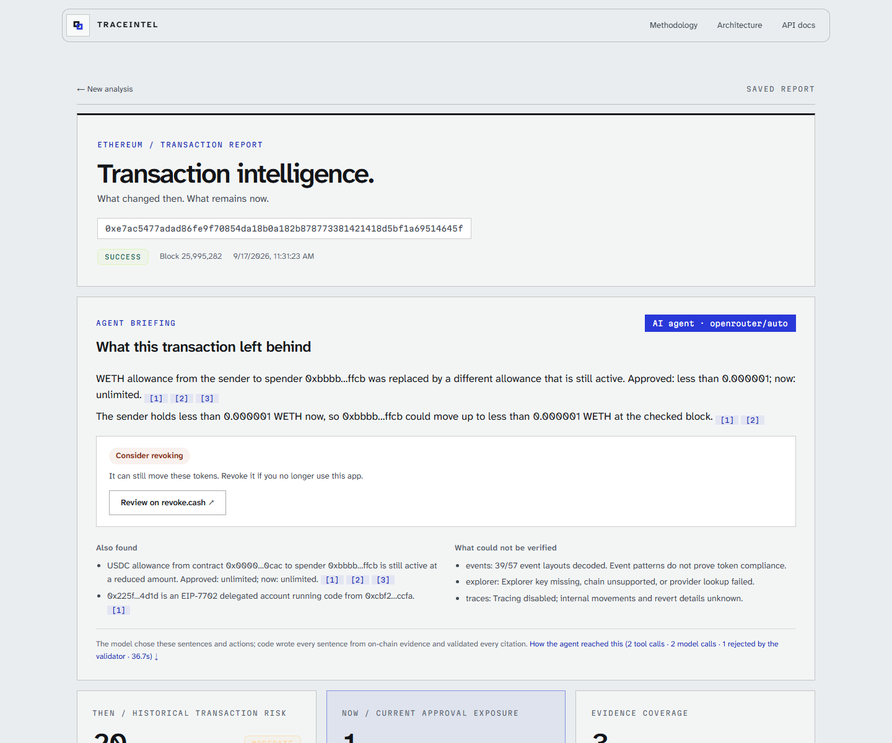
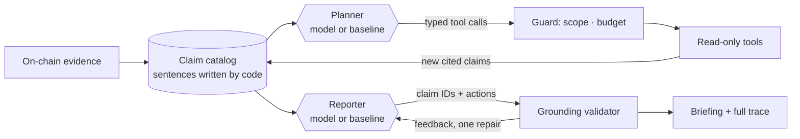

# TraceIntel

**What changed after you approved it?** TraceIntel reconstructs an old token approval, compares it with live on-chain state, and recommends whether to revoke it.

[Live app](https://traceintel.eshita.dev) · [1:44 walkthrough](https://drive.google.com/file/d/1-5eEX6gudDaP5FLFxx9WotcHQ9CJlThD/view) · [Methodology](https://traceintel.eshita.dev/methodology) · [Architecture](https://traceintel.eshita.dev/architecture) · [API docs](https://traceintel.eshita.dev/docs) · [How the agent works](docs/agents.md) · [Evaluations](evals/README.md)



**Try it without a wallet:** open the [live app](https://traceintel.eshita.dev) and pick one of the three recorded examples (two Ethereum transactions and one Monad transaction), or paste any transaction hash. Analysis is read-only and needs no wallet connection.

## Why it exists

Token approvals outlive the swaps that create them. An unlimited approval granted once stays live until it is revoked, so a wallet can be drained months later, without signing anything new, when the approved contract is upgraded, compromised or simply trusted with more than it needs. Block explorers show what a transaction did. They do not tell you what it still allows, or whether the contract you trusted then is the contract running now.

## What it does

Paste an Ethereum or Monad transaction hash. TraceIntel:

1. **Decodes** every approval the transaction emitted, and separates the sender's own from approvals that contracts granted each other mid-transaction.
2. **Checks today** each permission's allowance, the owner's balance and the spender's code, at one pinned and revalidated block (*then → now*).
3. **Investigates** the live permissions with an agent: who the spender is, whether it was upgraded or its code changed since the approval, and whether a single key controls its upgrades.
4. **Advises** per permission (*consider revoking*, *verify the spender* or *check who can upgrade it*), with every sentence linked to the on-chain evidence behind it.

It is read-only and needs no wallet connection.

## How the AI works, and why it cannot make things up



- **Models choose, code writes.** The model selects claim IDs and actions; code turns evidence into every sentence. A report cannot contain a fact, number or address that did not come from the chain.
- **A typed, bounded action space.** The planner can only request `spender_profile`, `upgrade_control` or `known_spender` on permission IDs that already exist in the evidence, and only for permissions the sender controls. Budgets are enforced in code.
- **Validate, then repair once.** Unknown IDs, or actions without a supporting claim, are rejected with precise feedback, and the reporter gets one attempt to fix them.
- **A deterministic baseline that is also the benchmark.** The same investigation and advice run without a model, and run instead when the model fails. Evaluations compare the two on labelled scenarios.
- **Hardened inputs.** Attacker-chosen token symbols and contract names never reach model input, and provider errors never reach reports or logs.
- **Auditable.** Every plan, tool call, rejection, repair and timing is stored with the report and shown as "How the agent worked".

Built on [NOOA](docs/nooa.md) (NVIDIA's agent framework) with OpenRouter models. Full design, trade-offs and rejected alternatives: [docs/agents.md](docs/agents.md).

## Evidence that it works

`make evaluate` runs **24 offline cases in CI**: historical rules, approval ownership on a real transaction, six exposure transitions, **eight labelled agent scenarios** (upgraded spender, key-held spender, single-key upgrades, recognised router, raised-to-unlimited, revoked, pruned history…) and **five adversarial guardrail cases** in which the model itself is scripted to misbehave. `scripts/verify_nooa_live.py` scores a real model against the rule-based baseline on the same scenarios. [Details](evals/README.md).

### Live model vs baseline (28 Oct 2026, free-tier OpenRouter key)

The same 8 labelled agent scenarios, with the on-chain world scripted so only the model varies. Raw results: [`evals/results/`](evals/results/).

| Run | Advice matches label | Grounded | Briefings written by the model | Model calls | Median time |
| --- | ---: | ---: | ---: | ---: | ---: |
| Rule-based baseline | 8 / 8 | 8 / 8 | n/a | 0 | under 0.1 s |
| `openrouter/auto` (production setting) | 4 / 8 | 8 / 8 | 8 / 8 | 19 | 24.9 s |
| `nvidia/nemotron-3.5-super-vl:free` | 7 / 8 | 8 / 8 | 0 / 8 | 7 | 44.9 s |

What this shows:

- **The guardrails held every time.** No run produced an ungrounded claim, including when the model's advice was wrong.
- **The model does not beat the baseline yet.** With free automatic routing it matched the label in 4 of 8 scenarios. That is why the baseline stays the benchmark and the fallback.
- **Failures degrade safely.** The pinned free model broke the required format or timed out in every scenario, so the baseline wrote all 8 briefings. One planning timeout left an investigation incomplete, and that is the single miss.
- **Limits.** 8 scenarios is a small sample, and `openrouter/auto` can route to different models from run to run.

## Engineering highlights

- **Correct under real chain conditions.** Reads are pinned to block hashes (EIP-1898) and revalidated, and reorgs invalidate state and cached reports. It falls back to labelled current state when providers prune history, recognises EIP-7702 delegated accounts and UNI-style uint96 "infinite" approvals, and keeps exact uint256 strings with no floats.
- **Production-shaped backend.** Job leases make stale workers stop. A self-healing heartbeat, atomic SQL budgets (per-client, daily, model), refunds for non-existent transactions, and structured logs that never contain secrets.
- **Strictly typed and tested.** Frozen Pydantic models, mypy strict, 66 backend tests on SQLite and PostgreSQL in CI, frontend unit tests, Playwright browser tests at four viewports, and a Docker smoke test.

## Networks

Ethereum and Monad share one EVM pipeline. Ethereum is where most approval risk and liquidity sit. Monad shows the pipeline is chain-agnostic on a high-throughput EVM. Adding a chain is a registry entry and an RPC URL.

## Stack

| Layer | Technology |
| --- | --- |
| Agent | NOOA `PredictStrategy`, OpenRouter, typed tool calls, grounding validator |
| Backend | Python 3.12, FastAPI, Pydantic, SQLAlchemy, Alembic |
| On-chain | EVM JSON-RPC, ABI and event decoding, ERC-20/721, EIP-1967, EIP-1898, EIP-7702 |
| Frontend | React 19, TypeScript, Vite |
| Infrastructure | Docker on Render, PostgreSQL, Cloudflare Workers, GitHub Actions |

## Run locally

Requires Python 3.12, uv, Node 22.12+, npm and Make. The backend needs Linux or macOS (NOOA imports `fcntl`); on Windows, use WSL.

```sh
cp .env.example .env   # once
make install
make backend           # terminal 1: migrations, then localhost:8000
make frontend          # terminal 2: localhost:5173
```

Without `OPENROUTER_API_KEY`, the rule-based baseline produces the investigation and advice, so everything works offline from a model. For drift checks, use an archive-capable RPC (the Ethereum default is one).

## Testing

```sh
make check        # lint, types, unit tests, build
make evaluate     # 24 offline evaluation cases
cd frontend && npx playwright install chromium && npm run test:e2e
```

## Deployment

[traceintel.eshita.dev](https://traceintel.eshita.dev) runs on Cloudflare → Render Docker → PostgreSQL. The demo backend uses Render's free tier, so the first visit after a quiet period can take up to two minutes to wake; the UI retries automatically. See [deployment](docs/deployment.md).

## Limitations

- Snapshots, not monitoring. "Now" is the recorded block.
- Analyzes one transaction's permissions, not a whole wallet; wallet-wide scans need an indexer.
- "Changed since approval" needs approval-block state. Free Monad RPCs keep about two weeks, so older checks are reported as unverifiable.
- EIP-1967 proxies only; UUPS upgrade authority inside implementations is reported as undetermined.
- ERC-4337 smart-account approvals appear as "other contracts", because their transactions are sent by bundlers.
- Risk scores and recommendations describe evidence. They are not safety ratings.

## License

MIT. See [LICENSE](LICENSE).
