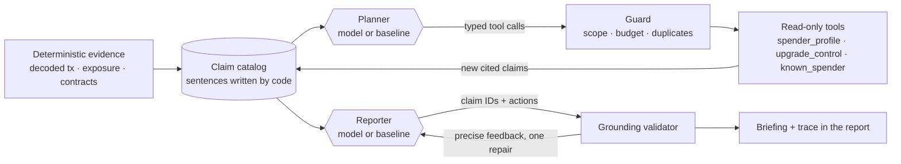

# The TraceIntel agent

TraceIntel's agent answers one question for the owner of a wallet: **of the permissions this transaction left behind, which can still move my tokens, has anything about them changed since I approved, and what should I do?**

This document explains how the agent is built, why it is built that way, and how it is evaluated.

## The constraint that shapes everything

In security tooling a confident wrong sentence is worse than no sentence. "This spender is safe" or an invented amount can cost users money. So the design starts from one rule:

> **Models choose. Code writes.**

A language model never authors a fact, a number, an address, a score or an exposure status. Code turns on-chain evidence into short claims, each with a stable ID and the evidence IDs it was derived from. The model decides *which checks to run* and *which claims and actions matter*, by ID. Code expands those IDs back into the code-written claims, so a report can only contain sentences that were derived from evidence.

## Architecture

| Module | Role |
| --- | --- |
| [`agents/catalog.py`](../backend/app/agents/catalog.py) | Builds the claim catalog. Gives each distinct permission an ID (`p0`, `p1`…), computes the reachable amount (`min(allowance, balance)`) and sanitises attacker-chosen labels. |
| [`agents/tools.py`](../backend/app/agents/tools.py) | Three deterministic, read-only tools. Each takes a permission ID, never an address, and returns code-written claims with fresh evidence. |
| [`agents/planner.py`](../backend/app/agents/planner.py) | `ModelPlanner` (NOOA `PredictStrategy`) and `BaselinePlanner` (fixed policy) behind one interface. |
| [`agents/investigator.py`](../backend/app/agents/investigator.py) | The loop: plan → validate → run tools in parallel → observe → repeat, under a code-enforced budget. Records the trace. |
| [`agents/reporter.py`](../backend/app/agents/reporter.py) | `Reporter` (NOOA) and `baseline_brief` (rules) produce a draft: summary, findings, uncertainties, actions and checks, all as claim IDs. |
| [`agents/validation.py`](../backend/app/agents/validation.py) | The grounding boundary. Rejects unknown IDs and actions that target permissions the sender does not control or that cite nothing about their permission. Returns every problem as feedback. |
| [`agents/service.py`](../backend/app/agents/service.py) | Orchestration, timeouts, the repair attempt, fallbacks and safe failure reasons. |

## The tools: what changed since you said yes?

The tools target the risk that matters after an approval: the approved contract today is not necessarily the contract you approved.

| Tool | Observes | Why it matters |
| --- | --- | --- |
| `spender_profile` | Whether the spender is a key-held account, an EIP-7702 delegated account, a contract or an EIP-1967 proxy now. Compares its bytecode and implementation with the state recorded at the approval block. | An upgraded proxy or changed code means the approval now trusts different logic. A key-held spender means whoever holds one key can move the tokens. |
| `upgrade_control` | The EIP-1967 admin slot, whether that admin is a single key or a contract, and the admin's `owner()`. | One private key able to replace the spender's logic is a concentrated point of failure. |
| `known_spender` | Whether the spender matches a published address of a widely used protocol (Permit2, Uniswap routers, Morpho Blue…). | Identity, not safety. The claim says so explicitly. |

Reads are pinned to the same block hash as the exposure snapshot (EIP-1898, `requireCanonical`), so the whole report describes one consistent chain state. When the RPC provider has pruned approval-block state, "changed since approval" becomes an explicit, cited uncertainty, never a guess. The default Ethereum RPC serves archive state for this reason.

## Guardrails, enforced in code rather than prompts

- **A typed action space.** The planner returns a `PlanStep` of `ToolCall(tool, permission_id)`. Tools come from a closed `Literal`, and IDs must name a live permission the sender controls. The model cannot reach an arbitrary address, method or URL; every RPC call still passes the client's read-only allowlist.
- **Budgets.** At most 2 model planning rounds (3 for the baseline), 8 tool calls and 4 per round. Duplicates and over-budget calls are rejected and recorded.
- **Scope.** Approvals that other contracts granted to each other mid-transaction belong to those contracts, so the agent neither investigates nor advises on them.
- **Grounding with one repair.** The validator lists every problem ("summary uses unknown claim IDs ['p0:safe']", "action for p1: not a live permission the sender controls"), and the reporter gets one attempt to fix them. A second failure falls back to the baseline and the report says so.
- **Injection resistance.** Claim text is built from code templates, addresses and enums. Token symbols and contract names are attacker-chosen, so only short, plain identifiers reach model input. Both prompts treat claim text as data. Even a successful injection could only reorder existing, true claims.
- **No secrets in reports.** Provider failures are classified by exception type ("the provider rejected the API key (AuthenticationError)"). Provider messages, which can echo keys or URLs, are never stored or logged.
- **Graceful degradation.** With no model, a failed model, an exhausted budget or invalid output, the deterministic baseline still investigates and advises. The report states who wrote the briefing and why.

## The baseline is the benchmark

Every model role has a deterministic twin:

- `BaselinePlanner` profiles and identifies each live permission's spender, then checks upgrade control for spenders that turned out to be proxies. It never declares itself done while a batch could still reveal a proxy.
- `baseline_brief` advises *consider revoking* for upgraded, changed or key-held spenders, single-key upgrade control, or any permission unlimited now (including one raised to unlimited after the transaction). It advises *verify spender* for unrecognised spenders and *review upgrade control* for proxies with undetermined control.

This answers the first interview question about any agent, "why do you need an LLM here?", with a measurement rather than an assertion. The live evaluation runs both on the same labelled scenarios. The model planner is only engaged when there are at least two permissions to prioritise, so model calls go where judgement can add value.

## The trace

Every report stores the run: each plan, every requested call (accepted or rejected, and why), tool results with the claim IDs they produced, validation outcomes, repairs, model calls and durations. The report page renders it as "How the agent worked", so any recommendation can be audited back to the RPC call behind it.

## Evaluation

`make evaluate` runs offline in CI ([details](../evals/README.md)). The agent cases are:

- **Eight labelled scenarios** over the real recorded approval transaction, each with a scripted RPC world: upgraded spender, key-held spender, single-key upgrade control, recognised router unchanged, unrecognised contract, recognised protocol later raised to unlimited, allowance already revoked, and pruned approval-block state. Each checks the advice, the required citations, the uncertainties, grounding (every selected claim exists verbatim and cites known evidence) and the tool budget.
- **Five adversarial cases** that script the model itself: out-of-scope and duplicate tool calls, an invented claim repaired after feedback, advice on another owner's permission (falls back to baseline), an injected token symbol, and a provider that rejects the key.

`scripts/verify_nooa_live.py` runs the same scenarios with a real model through OpenRouter and writes advice accuracy, grounding rate, repairs, model calls and latency next to the baseline into `evals/results/`.

## Alternatives considered

| Alternative | Why not |
| --- | --- |
| Let the model write the summary, then fact-check it | Free text needs fuzzy verification of numbers, addresses and negations, and fact-checkers miss things. Selecting IDs makes grounding exact and cheap. |
| Free-form function calling over raw RPC | Gives the model an open-ended capability surface (any address, any method) and makes budgets and auditing harder. A typed action space over evidence IDs keeps the agent useful and bounded. |
| CodeAct (model writes code) | Powerful, but a security tool should not execute model-written code against user-supplied inputs. |
| Copy claims verbatim (the previous design) | Any paraphrase was a hard rejection, outputs were long and slow, and three agents re-selected the same claims. IDs removed that whole class of failure. |
| One model call, no tools | Cannot follow up. Whether to check upgrade control depends on what the profile found. |

## Known limitations

- Drift detection needs approval-block state. Free Monad RPCs keep about two weeks, so older Monad approvals are reported as unverifiable.
- `upgrade_control` covers EIP-1967 admin slots. UUPS authority inside the implementation is reported as undetermined.
- The known-spender registry is deliberately small. An address match identifies a contract; it never implies safety.
- The agent explains one transaction's permissions. It does not scan a whole wallet; that needs an indexer.
