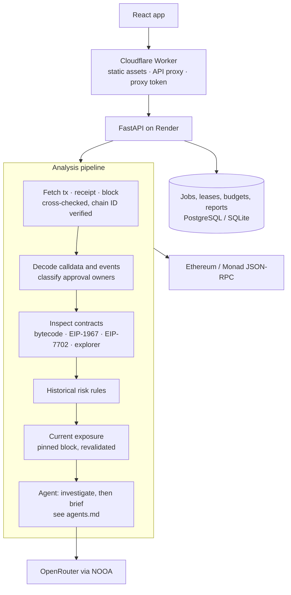

# Architecture

Python 3.12 / FastAPI backend, React 19 / Vite frontend served by a Cloudflare Worker, PostgreSQL in production.

## Evidence boundary

RPC acquisition cross-checks transaction, receipt and block identity and verifies the chain ID. The decoder emits frozen Pydantic models with tuple collections; nested raw objects are stored as JSON text, so nothing downstream can mutate evidence. Evidence IDs encode chain, transaction and source location, and every risk signal, exposure state and agent claim carries the IDs it was derived from.

Each approval's owner is classified relative to the transaction: `sender`, `called_contract` (possibly the sender's smart wallet) or `other` (a contract acting mid-transaction). Only the sender's approvals are scored. The others are still checked and shown, because they describe those contracts' permissions, not the sender's.

Contract state is read at the transaction block. When a provider has pruned that state, the inspector falls back to the latest block and labels the evidence and coverage accordingly. EIP-7702 delegation designators are classified as delegated accounts, not contracts.

## Deterministic layers

Risk rules operate only on decoded evidence: fixed weights, no negative adjustments, one contribution per rule code ([methodology](methodology.md)). Current exposure reads allowance, balance and spender code at one block pinned by hash with `requireCanonical`, then revalidates the block ([exposure](exposure.md)). Coverage is reported separately and missing data never lowers a score.

## Agent layer

A planner (model or deterministic baseline) chooses read-only follow-up checks within a code-enforced budget. Tools observe the chain at the exposure snapshot's block, and a reporter selects claim IDs and per-permission actions that a validator checks before code expands them into evidence-derived sentences. The full trace is stored with the report. See [the agent design](agents.md).

## Services and persistence

`AnalysisService` owns sequencing and bounded async work. It depends on a `ReportRepository` protocol, not SQLAlchemy. The SQL adapter supports SQLite and PostgreSQL, with schema history in Alembic.

Jobs persist their real stage. Cache keys combine chain, hash, pipeline version, a five-minute snapshot bucket and the interpretation configuration; cached reports revalidate their block hash before reuse. Every job update is conditional on this process holding a live lease, and an update that no longer applies stops the work. A heartbeat renews leases every 15 seconds. It fails closed while the database is unhealthy, cancels local work only after three missed beats (before the 60-second lease could be recovered elsewhere) and heals by itself.

A semaphore bounds active pipelines; the queue, per-client hourly requests (IPv6 bucketed per /64), daily analyses and daily model analyses are capped with atomic SQL budget updates. A transaction that turns out not to exist refunds its daily reservation.

## Observability

The API logs job IDs, stage transitions, durations, lease health and failure sites. For unexpected errors it logs the exception type and the application frames involved, never the exception message, because RPC errors can embed credential-bearing URLs. Model failures are classified into safe, specific reasons stored in the report.

## Hosting

Cloudflare serves traceintel.eshita.dev and proxies API requests to a Render Docker service (free compute in Singapore, which sleeps when idle) with PostgreSQL. A shared origin token protects writes; client identity is accepted only through the authenticated proxy. No secrets are bundled into frontend assets. See [deployment](deployment.md).

## Interface references

[Desktop workspace](screenshots/landing.png), [mobile workspace](screenshots/landing-mobile.png), [report](screenshots/exposure-dashboard.png) and [mobile report](screenshots/exposure-mobile.png) are captured by the browser suite.
